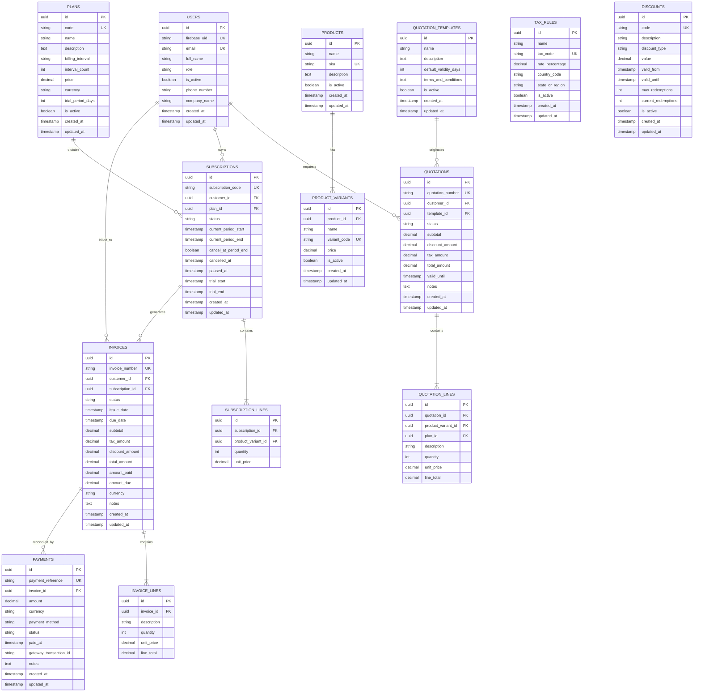

# BRIGHTLOOP — SUBSCRIPTION MANAGEMENT SYSTEM
## Single Source of Truth & Architecture Guide (PROJECT_CONTEXT.md)

> **Document Status**: Active / Baseline Initialized  
> **Initial Author**: Developer 1 (Project Setup Owner)  
> **Last Updated**: 2026-10-31  
> **Target Audience**: Developer 1, Developer 2, Developer 3, and automated coding agents  
> **Rule of Engagement**: *Never represent planned functionality as implemented functionality.*

---

## A. Project Overview

### 1. Project Name & Description
**Brightloop** is a high-performance, modular monolithic Subscription Management System designed for modern SaaS and recurring-service businesses. It unifies the entire recurring revenue lifecycle: product cataloging, multi-interval subscription terms, dynamic quoting, automated billing and invoice generation, regional taxation, promotional discounting, payment reconciliation, and customer self-service.

### 2. Problem Statement
Businesses handling recurring subscription models often struggle with fragmented tooling across quotation drafting, subscription lifecycle tracking (upgrades, pauses, cancellations), complex billing cycles (daily, weekly, monthly, yearly), tax liability calculations, and payment reconciliation. Brightloop delivers a unified, performant, and reliable platform capable of orchestrating thousands of concurrent subscriptions with sub-2-second response latency.

### 3. Core Objectives
1. **Unified Recurring Revenue Engine**: Provide an integrated suite spanning product definition to invoice reconciliation.
2. **Flexible Cadence Support**: Native scheduling for daily, weekly, monthly, and yearly billing cycles.
3. **High Performance & Low Latency**: Sub-2-second page response times under load across thousands of active subscriptions.
4. **Developer Isolation & Parallel Velocity**: Clear contract boundaries separating frontend, API routes, data models, and business logic for simultaneous multi-developer collaboration.

### 4. Functional Requirements
1. **User Authentication & Security**: User registration, JWT login, password reset, and role-based access control (Admin, Staff, Customer).
2. **Product Catalog**: Multi-variant products, add-on components, and pricing tiers.
3. **Subscription Plans**: Flexible terms, currencies, trial period definitions, and billing intervals (Daily, Weekly, Monthly, Yearly).
4. **Quotation Engine**: Reusable quotation templates, quotation drafting, customer approval workflow, and one-click conversion to active subscriptions.
5. **Subscription Lifecycle Management**: State machine transitions (`draft`, `trialing`, `active`, `paused`, `cancelled`, `expired`), prorations, renewals, and cancellations at period end.
6. **Automated Recurring Invoicing**: Scheduled invoice generation, PDF/HTML generation, due-date management, and balance tracking.
7. **Taxation Engine**: Regional, national, and item-specific tax rules with automated calculation.
8. **Discounts & Promotions**: Percentage-based and fixed-amount coupons with usage tracking and expiry dates.
9. **Payment Recording & Reconciliation**: Payment recording, manual/gateway transaction tracking, and automatic invoice balancing.
10. **Analytics & Reporting**: MRR (Monthly Recurring Revenue), ARR, churn rate, renewal rates, and cohort analytics.
11. **Customer Self-Service Portal**: Customer dashboard to inspect active plans, download invoices, request changes, and review payment history.

---

## B. Technology Stack

### Frontend
| Component | Technology | Version | Purpose |
| :--- | :--- | :--- | :--- |
| **Framework** | React | `^19.3.1` | Declarative component UI library |
| **Build Tool** | Vite | `^8.3.5` | Next-generation dev server & production bundler |
| **Styling** | Tailwind CSS | `^4.0.0` (`@tailwindcss/vite`) | Utility-first styling with zero runtime |
| **Routing** | React Router DOM | `^7.1.0` | Client-side routing and layout management |
| **HTTP Client** | Axios | `^1.7.9` | Interceptor-driven HTTP requests with token injection |
| **Analytics Charts**| Recharts | `^2.15.0` | Responsive SVG/canvas analytics visualizations |
| **Icons** | Lucide React | `^0.474.0` | Lightweight consistent iconography |

### Backend
| Component | Technology | Version | Purpose |
| :--- | :--- | :--- | :--- |
| **Language** | Python | `3.12.3` | Modern backend runtime |
| **Web Framework** | FastAPI | `0.115.6` | Asynchronous, OpenAPI-compliant REST framework |
| **ASGI Server** | Uvicorn | `0.34.0` | High-throughput asynchronous server |
| **ORM / Query Engine**| SQLAlchemy | `2.0.36` | Declarative 2.0 async/sync database toolkit |
| **Database Driver** | asyncpg | `0.30.0` | High-performance asynchronous PostgreSQL driver |
| **Sync Driver / CLI**| psycopg2-binary | `2.9.10` | Synchronous driver for migrations and tooling |
| **Schema Validation**| Pydantic / Pydantic Settings | `2.10.4` / `2.7.0` | Strict data validation and environment config |
| **Migrations** | Alembic | `1.14.0` | Database schema version control |
| **Authentication** | Firebase Admin SDK | `6.6.0` | Firebase ID token verification, user management, and link generation |
| **Testing** | Pytest & pytest-asyncio | `8.3.4` / `0.25.0` | Async automated test harness (in-memory SQLite + aiosqlite) |
| **Test Client** | HTTPX | `0.28.1` | Async ASGI testing client |

### Database & Infrastructure
| Component | Technology | Purpose |
| :--- | :--- | :--- |
| **Database** | PostgreSQL 16 (Alpine) | ACID-compliant relational data store |
| **Containerization**| Docker & Docker Compose | Local reproducible database runtime (`docker-compose.yml`) |
| **Version Control** | Git | Branching and code review management |

---

## C. Architecture

### 1. Modular Monolithic Architecture
Brightloop uses a clean **Modular Monolith** pattern. The application is maintained in a single version-controlled repository (monorepo) with strict decoupling between the frontend single-page application (SPA) and the backend API server.

```
       +-------------------------------------------------------+
       |                  React + Vite SPA                     |
       |  (Pages -> Components -> Layouts -> Context -> API)   |
       +---------------------------+---------------------------+
                                   | HTTP/REST (JSON + JWT)
                                   v
       +-------------------------------------------------------+
       |                  FastAPI Backend                      |
       |  [API Routers (/api/v1)]  -->  [Dependencies / Auth]  |
       |             |                                         |
       |             v                                         |
       |      [Services Layer]     -->  [Pydantic Schemas]     |
       |             |                                         |
       |             v                                         |
       |   [SQLAlchemy 2.0 Models] -->  [PostgreSQL Connection]|
       +-------------------------------------------------------+
```

### 2. Backend Responsibilities & Layer Separation
* **API Routers (`app/api/v1/`)**: Pure HTTP handling, status codes, query parameter parsing, and schema delegation. Routers contain no SQL queries or business computations.
* **Dependencies & Auth (`app/api/deps.py`, `app/core/security.py`)**: Token validation, session lifecycle injection, and role-based permissions (`admin`, `staff`, `customer`).
* **Services (`app/services/`)**: Core domain logic (subscription state transitions, recurring invoice billing loops, prorations, tax calculations).
* **Models (`app/models/`)**: SQLAlchemy 2.0 mapped entities defining tables, foreign keys, cascade rules, and indexes.
* **Schemas (`app/schemas/`)**: Pydantic models for incoming payload validation and JSON serialization.
* **Database & Config (`app/db/`, `app/core/config.py`)**: Connection pool management (`asyncpg` for request lifecycles, `psycopg2` for Alembic) and environment variable resolution.

### 3. Frontend Responsibilities & Layer Separation
* **Pages (`src/pages/`)**: Route-level components combining layouts, state, and domain views.
* **Components (`src/components/`)**: Reusable dumb UI components (cards, badges, tables, modals).
* **Layouts (`src/layouts/`)**: Structural page chrome (navigation header, sidebar, footer).
* **API Services (`src/api/client.js`)**: Axios instance configuring base URL, timeout, and JWT request/response interceptors.
* **Hooks & Context (`src/hooks/`, `src/context/`)**: AuthContext managing login tokens and user sessions.
* **Utilities (`src/utils/`)**: Formatters for currency, dates, and domain constants.

### 4. API Communication Approach
* All API communication happens over HTTP/JSON under the `/api/v1` namespace.
* Standardized CORS policy allows requests from local Vite development servers (`http://localhost:5173`).
* Authentication uses `Authorization: Bearer <JWT_ACCESS_TOKEN>`.
* Responses follow predictable JSON envelopes. Errors return `{ "detail": "Descriptive message" }`.

---

## D. Directory Structure

The project has been initialized with the following structure:

```
D:\odo\
├── .gitignore                      # Root ignore rules for Python, Node, env, IDE, DB
├── docker-compose.yml              # Local PostgreSQL 16 container definition
├── README.md                       # Quickstart onboarding guide
├── PROJECT_CONTEXT.md              # Central single source of truth (this document)
│
├── backend/
│   ├── .env.example                # Template backend configuration
│   ├── pyproject.toml              # Project metadata and tool configuration
│   ├── pytest.ini                  # Pytest configuration (asyncio mode auto)
│   ├── requirements.txt            # Locked Python backend dependencies
│   ├── alembic.ini                 # Alembic migration configuration
│   ├── alembic/
│   │   ├── env.py                  # Async migration runner linked to app.models
│   │   ├── script.py.mako          # Migration template
│   │   └── versions/               # Schema migration versions directory
│   ├── app/
│   │   ├── __init__.py             # Version metadata (0.1.0)
│   │   ├── main.py                 # FastAPI application factory, CORS, and root routes
│   │   ├── cli/
│   │   │   ├── __init__.py
│   │   │   └── bootstrap_admin.py  # One-time atomic admin bootstrap CLI
│   │   ├── core/
│   │   │   ├── __init__.py
│   │   │   ├── config.py           # Pydantic Settings (DB, CORS, Firebase, SMTP)
│   │   │   ├── firebase.py         # Firebase Admin SDK initialization & auth helpers
│   │   │   └── security.py         # Token verification bridge
│   │   ├── db/
│   │   │   ├── __init__.py
│   │   │   ├── base.py             # DeclarativeBase & TimestampMixin
│   │   │   └── session.py          # Async & sync SQLAlchemy engines, get_db dependency
│   │   ├── models/                 # SQLAlchemy 2.0 ORM Entities
│   │   │   ├── __init__.py         # Central export of all database models
│   │   │   ├── user.py             # User (firebase_uid) and UserRole enum
│   │   │   ├── product.py          # Product and ProductVariant
│   │   │   ├── plan.py             # Plan and BillingInterval enum
│   │   │   ├── quotation.py        # QuotationTemplate, Quotation, QuotationLine
│   │   │   ├── subscription.py     # Subscription, SubscriptionLine, SubscriptionStatus
│   │   │   ├── tax.py              # TaxRule
│   │   │   ├── discount.py         # Discount and DiscountType enum
│   │   │   ├── invoice.py          # Invoice, InvoiceLine, InvoiceStatus
│   │   │   └── payment.py          # Payment, PaymentMethod, PaymentStatus
│   │   ├── schemas/                # Pydantic Request/Response validation models
│   │   │   ├── __init__.py
│   │   │   ├── common.py           # HealthResponse, MessageResponse, PaginatedResponse
│   │   │   ├── token.py            # Token and TokenPayload
│   │   │   ├── user.py             # CustomerProfileCreateRequest, StaffCreate, UserResponse
│   │   │   ├── subscription.py     # SubscriptionCreate, SubscriptionUpdate, SubscriptionResponse
│   │   │   └── invoice.py          # InvoiceCreate, InvoiceResponse, InvoiceLineResponse
│   │   ├── api/
│   │   │   ├── __init__.py
│   │   │   ├── deps.py             # get_db, get_current_user, require_roles
│   │   │   └── v1/
│   │   │       ├── __init__.py
│   │   │       ├── router.py       # API router aggregating v1 endpoint routers
│   │   │       └── endpoints/
│   │   │           ├── __init__.py
│   │   │           ├── health.py   # System health diagnostic endpoint
│   │   │           └── users.py    # Profile, Staff provisioning, User listing endpoints
│   │   └── services/               # Domain service modules
│   │       ├── __init__.py
│   │       ├── email_service.py    # Transactional SMTP email delivery
│   │       └── user_service.py     # User domain & compensation lifecycle logic
│   └── tests/
│       ├── __init__.py
│       ├── conftest.py             # In-memory SQLite fixtures & Firebase mock spies
│       ├── test_health.py          # Verified health & root endpoint tests
│       ├── test_auth_firebase.py   # Firebase authentication & safe email sync tests
│       ├── test_users.py           # Staff provisioning, compensation & listing tests
│       ├── test_bootstrap_cli.py   # Atomic Admin bootstrap CLI tests
│       └── test_production_config.py # Production environment validation tests
│
└── frontend/
    ├── .env.example                # Frontend environment template
    ├── package.json                # Dependencies: React 19, Tailwind v4, Recharts, Router
    ├── vite.config.js              # Vite configuration with @tailwindcss/vite
    ├── index.html                  # HTML entry point
    └── src/
        ├── main.jsx                # React root bootstrap
        ├── App.jsx                 # Route definitions and AuthProvider
        ├── index.css               # Tailwind CSS v4 setup and typography
        ├── App.css                 # Custom styling
        ├── api/
        │   └── client.js           # Axios client with bearer interceptor & health service
        ├── components/
        │   ├── Navbar.jsx          # Top header with dynamic backend health status
        │   ├── Sidebar.jsx         # Collapsible navigation menu
        │   ├── MetricCard.jsx      # Reusable dashboard metric card
        │   └── StatusBadge.jsx     # Reusable colored status chip
        ├── layouts/
        │   └── MainLayout.jsx      # Shell layout hosting navbar, sidebar, and outlet
        ├── pages/
        │   ├── DashboardPage.jsx   # Metrics, Recharts MRR area chart, status notice
        │   ├── SubscriptionsPage.jsx # Subscriptions table and creation placeholder
        │   ├── InvoicesPage.jsx    # Invoices table and creation placeholder
        │   ├── LoginPage.jsx       # Authentication entry view
        │   └── NotFoundPage.jsx    # 404 handler
        ├── hooks/
        │   └── useAuth.js          # Authentication hook
        ├── context/
        │   └── AuthContext.jsx     # React Context for auth session management
        └── utils/
            ├── constants.js        # Domain intervals, statuses, and roles
            └── formatters.js       # Currency and date formatters
```

---

## E. Database Design (PLANNED)

The following database entities and schema relationships are planned. The foundational SQLAlchemy ORM models have been created in `backend/app/models/` and are ready for Alembic migration generation.

### Entity Relationship Diagram (Planned)



### Proposed Additional Entities (Planned)
* **AuditLog**: `[PLANNED]` Tracking sensitive subscription actions (plan changes, cancellations, manual invoice adjustments).
* **PaymentMethod**: `[PLANNED]` Stored customer payment tokens or credit card profiles for automated recurring charges.

---

## F. API Contracts (PLANNED)

All endpoints below are prefixed with `/api/v1` and are marked with their implementation status.

### 1. System & Health
* `GET /api/v1/health` — **[IMPLEMENTED & TESTED]**  
  Returns system health, app name, version, and server timestamp.
* `GET /` — **[IMPLEMENTED & TESTED]**  
  Root API discovery endpoint linking to docs and health checks.

### 2. Authentication & Users
* `POST /api/v1/users/profile` — **[IMPLEMENTED & TESTED]**  
  Headers: `Authorization: Bearer <firebase_id_token>`  
  Body: `{ full_name, phone_number, company_name }` (optional)  
  Initializes or retrieves the authenticated user's `CUSTOMER` profile in PostgreSQL. Fully idempotent under concurrent calls.
* `GET /api/v1/users/me` — **[IMPLEMENTED & TESTED]**  
  Headers: `Authorization: Bearer <firebase_id_token>`  
  Returns the current user profile. Safely synchronizes verified Firebase email if changed (with duplicate collision protection).
* `POST /api/v1/users/staff` — **[IMPLEMENTED & TESTED]**  
  Role: `ADMIN` only  
  Body: `{ email, full_name, phone_number, company_name }`  
  Creates a Firebase account and PostgreSQL `STAFF` record. Generates password setup and email verification links. Reverts Firebase account via transactional compensation if PostgreSQL commit fails. In development mode (`APP_ENV=development` & `DEBUG=True`), links are returned in response; in production, delivered via SMTP.
* `POST /api/v1/users/staff/{id}/resend-setup-link` — **[IMPLEMENTED & TESTED]**  
  Role: `ADMIN` only  
  Re-generates password setup and email verification links for pending staff accounts. Rejects with HTTP 409 Conflict if the staff account has already verified their email.
* `GET /api/v1/users` — **[IMPLEMENTED & TESTED]**  
  Role: `ADMIN` (can list all users or filter by role) or `STAFF` (strictly restricted to viewing `customer` users only). Customers receive HTTP 403 Forbidden.  
  Query params: `role`, `skip`, `limit`  
  Returns: `list[UserResponse]`
* `CLI: app.cli.bootstrap_admin` — **[IMPLEMENTED & TESTED]**  
  One-time administrator bootstrap script protected by PostgreSQL advisory transaction lock (`pg_advisory_xact_lock(42424242)`). Requires pre-existing verified Firebase identity and aborts if an active administrator already exists.  
  Usage: `python -m app.cli.bootstrap_admin --firebase-uid <UID> --email <EMAIL> --full-name <NAME>`

### 3. Products & Product Variants
* `GET /api/v1/products` — **[PLANNED]**  
  Returns list of products with active variants.
* `POST /api/v1/products` — **[PLANNED]**  
  Role: `Admin`, `Staff`  
  Body: `{ name, sku, description }`
* `POST /api/v1/products/{product_id}/variants` — **[PLANNED]**  
  Role: `Admin`, `Staff`  
  Body: `{ name, variant_code, price }`

### 4. Plans
* `GET /api/v1/plans` — **[PLANNED]**  
  Query params: `billing_interval`, `is_active`  
  Returns list of plans.
* `POST /api/v1/plans` — **[PLANNED]**  
  Role: `Admin`  
  Body: `{ code, name, description, billing_interval, interval_count, price, currency, trial_period_days }`

### 5. Quotation Templates & Quotations
* `GET /api/v1/quotation-templates` — **[PLANNED]**
* `POST /api/v1/quotations` — **[PLANNED]**  
  Body: `{ customer_id, template_id, valid_until, lines: [...] }`
* `POST /api/v1/quotations/{id}/accept` — **[PLANNED]**  
  Transitions status to `accepted` and triggers conversion to subscription.

### 6. Subscriptions
* `GET /api/v1/subscriptions` — **[PLANNED]**  
  Query params: `status`, `customer_id`, `page`, `page_size`
* `POST /api/v1/subscriptions` — **[PLANNED]**  
  Body: `{ customer_id, plan_id, trial_days, lines: [...] }`
* `POST /api/v1/subscriptions/{id}/pause` — **[PLANNED]**
* `POST /api/v1/subscriptions/{id}/resume` — **[PLANNED]**
* `POST /api/v1/subscriptions/{id}/cancel` — **[PLANNED]**  
  Body: `{ cancel_at_period_end: bool }`

### 7. Invoices & Billing
* `GET /api/v1/invoices` — **[PLANNED]**  
  Query params: `customer_id`, `subscription_id`, `status`
* `POST /api/v1/invoices/generate-recurring` — **[PLANNED]**  
  Role: `Admin`, `Staff` or Background Scheduler. Generates due invoices for subscriptions reaching period end.

### 8. Payments & Reconciliation
* `GET /api/v1/payments` — **[PLANNED]**
* `POST /api/v1/payments` — **[PLANNED]**  
  Body: `{ invoice_id, amount, payment_method, gateway_transaction_id, notes }`  
  Reconciles invoice `amount_paid` and `amount_due`. Updates status to `paid` if `amount_due == 0`.

### 9. Analytics & Reporting
* `GET /api/v1/analytics/dashboard` — **[PLANNED]**  
  Returns MRR, ARR, active subscriber counts, churn rate, and period revenue curves.

---

## G. Implementation Status Matrix

| Module / Component | Category | Current Status | Notes |
| :--- | :--- | :--- | :--- |
| **Project Directory & Git Scaffold** | Setup | **IMPLEMENTED** | Dedicated initialization branch created |
| **React + Vite Frontend Scaffold** | Frontend | **IMPLEMENTED** | Vite 8 + React 19 + Tailwind v4 compiling |
| **FastAPI Backend Core & Lifespan** | Backend | **IMPLEMENTED** | Async lifespan, CORS, settings management |
| **Health Check & Diagnostics** | API | **TESTED** | `/api/v1/health` and `/` passing pytest suite |
| **SQLAlchemy 2.0 ORM Entity Models** | Database | **IMPLEMENTED** | All 13 core entities modeled in `app/models/` |
| **Alembic Database Migration Runner**| Database | **IMPLEMENTED** | Async migration runner linked to model metadata |
| **Docker Compose PostgreSQL Service**| Database | **IMPLEMENTED** | PostgreSQL 16 Alpine container configured |
| **Frontend Layout & Navigation** | Frontend | **IMPLEMENTED** | MainLayout, Navbar, Sidebar, StatusBadge |
| **Frontend Recharts Integration** | Frontend | **IMPLEMENTED** | Working MRR AreaChart on DashboardPage |
| **Frontend Axios API Client** | Frontend | **IMPLEMENTED** | Token interceptors & health service integration |
| **User Authentication (Firebase Auth & PostgreSQL RBAC)**| Backend | **IMPLEMENTED & TESTED** | Firebase ID token verification, safe email sync, staff provisioning, atomic admin bootstrap CLI, 31 pytest tests passing |
| **User Registration & Login UI** | Frontend | **PLANNED** | Skeleton LoginPage created; API hookup planned |
| **Product & Variant Catalog Engine** | Domain | **PLANNED** | Models exist; service & API routers planned |
| **Subscription Plan Management** | Domain | **PLANNED** | Models exist; daily/weekly/monthly/yearly planned |
| **Quotation Templates & Quoting** | Domain | **PLANNED** | Models exist; acceptance workflow planned |
| **Subscription Lifecycle Machine** | Domain | **PLANNED** | Models exist; pause/resume/cancel logic planned |
| **Automated Recurring Invoicing** | Domain | **PLANNED** | Models exist; recurring batch generator planned |
| **Tax Rules & Calculations** | Domain | **PLANNED** | Models exist; jurisdiction calculator planned |
| **Promotional Discount Engine** | Domain | **PLANNED** | Models exist; percentage/fixed engine planned |
| **Payment Reconciliation Engine** | Domain | **PLANNED** | Models exist; invoice balance updater planned |
| **Customer Self-Service Portal** | Frontend | **PLANNED** | Customer-facing route permissions planned |

---

## H. Developer Responsibilities

To ensure non-conflicting parallel execution across developers on different machines:

### Developer 1 (Initial Setup Owner & Backend Lead)
* **Scope**: Project initialization, Core Backend Infrastructure, Database Schema & Migrations, Billing & Invoicing Engine.
* **Key Tasks**:
  1. Complete project setup, repository scaffolding, and single source of truth documentation.
  2. Implement Database Migrations via Alembic for all planned models.
  3. Implement the Plan & Product Catalog service and endpoints (`/api/v1/products`, `/api/v1/plans`).
  4. Implement the Recurring Billing Engine & Invoice Generator service (`/api/v1/invoices`).
  5. Implement Payment Recording & Reconciliation logic (`/api/v1/payments`).

### Developer 2 (Frontend Lead & Authentication Specialist)
* **Scope**: Authentication & Authorization, Customer & Admin Frontend Pages, Self-Service Portal.
* **Key Tasks**:
  1. Implement Authentication endpoints in backend (`/api/v1/auth/register`, `/api/v1/auth/login`, `/api/v1/users/me`).
  2. Connect Frontend `AuthContext` to backend token endpoints.
  3. Build full UI pages for Subscriptions, Plans, Products, and Invoices using the established design system.
  4. Implement Customer Self-Service Portal views (read-only subscriptions, invoice download, payment review).
  5. Coordinate API contracts with Developer 1 before modifying endpoint shapes.

### Developer 3 (Analytics, Tax & Quotation Specialist)
* **Scope**: Quotations Engine, Tax & Discount Engines, Revenue & Subscription Analytics.
* **Key Tasks**:
  1. Implement Quotation Templates and Quotations CRUD (`/api/v1/quotations`).
  2. Implement Quotation-to-Subscription conversion workflow.
  3. Implement Tax Rules calculator and Discount redemption validator.
  4. Build analytics aggregation queries (MRR, churn rate, cohort retention).
  5. Implement rich Recharts analytics dashboards on the frontend.

---

## I. Technical Decisions

1. **Modular Monolith over Microservices**:
   * *Decision*: Structure both backend and frontend inside a single monorepo while keeping them independently deployable.
   * *Rationale*: For a fast-paced hackathon and sub-2-second latency requirements, in-process service boundaries eliminate network serialization overhead, distributed transactions, and deployment complexities.

2. **SQLAlchemy 2.0 with Asyncpg & Psycopg2**:
   * *Decision*: Use `asyncpg` for high-concurrency async endpoint handling, and `psycopg2-binary` for synchronous Alembic migrations.
   * *Rationale*: Async I/O handles high concurrency without blocking the event loop. Sync Alembic ensures simple, reliable migration execution without async event loop collisions.

3. **Tailwind CSS v4 with `@tailwindcss/vite`**:
   * *Decision*: Use the official Vite plugin for Tailwind v4 with zero-config `@import "tailwindcss";`.
   * *Rationale*: Lightning-fast build times (under 1.3 seconds for production builds), clean CSS bundle sizes, and full utility styling without maintaining extensive CSS files.

4. **Firebase Authentication with PostgreSQL RBAC**:
   * *Decision*: Delegate customer registration, password management, email verification, and session tokens to Firebase Authentication. Store business profiles and authorize roles (`admin`, `staff`, `customer`) strictly inside PostgreSQL.
   * *Rationale*: Eliminates password storage and cryptographic token signing vulnerabilities in the application layer while enforcing strict multi-tenant authorization and auditability in relational PostgreSQL.

---

## J. Known Issues & Limitations

1. **Database Container Not Running Automatically**:
   * *Limitation*: PostgreSQL requires Docker to be running locally (`docker compose up -d`). If Docker is not available, a local PostgreSQL server or SQLite fallback can be configured in `.env`.
2. **Mock Data on Frontend Pages**:
   * *Limitation*: The Subscriptions and Invoices pages currently display placeholder mock data until Developer 1 and Developer 2 implement the corresponding API endpoints.
3. **Pending Seed Data**:
   * *Limitation*: Database seed scripts for initial admin users and sample subscription plans are planned for Phase 2.

---

## K. Setup Instructions

### Prerequisites
* **Node.js**: v18+ (verified on v24.14.0) and **npm** v9+ (verified on v11.9.0)
* **Python**: 3.11+ (verified on Python 3.12.3)
* **Docker & Docker Compose** (optional, for local PostgreSQL)

### Step 1: Clone and Checkout Branch
```bash
git clone <repository-url>
cd odo
git checkout init/project-setup
```

### Step 2: Start PostgreSQL Database
```bash
# Start PostgreSQL via Docker Compose
docker compose up -d

# Verify container is healthy
docker compose ps
```

### Step 3: Backend Setup
```bash
# Navigate to backend directory
cd backend

# Create virtual environment (if not already created)
python -m venv .venv

# Activate virtual environment
# Windows (PowerShell):
.venv\Scripts\Activate.ps1
# Linux/macOS:
source .venv/bin/activate

# Install locked dependencies
pip install -r requirements.txt

# Create environment configuration
copy .env.example .env

# Run automated tests to verify setup
pytest -v

# Start backend server
uvicorn app.main:app --reload --host 127.0.0.1 --port 8000
```
* **Interactive API Documentation (Swagger)**: http://127.0.0.1:8000/docs  
* **ReDoc Documentation**: http://127.0.0.1:8000/redoc  
* **Health Check**: http://127.0.0.1:8000/api/v1/health  

### Step 4: Frontend Setup
```bash
# In a new terminal, navigate to frontend directory
cd frontend

# Install dependencies
npm install

# Create environment configuration
copy .env.example .env

# Start Vite development server
npm run dev
```
* **Frontend Application**: http://localhost:5173  
* The navigation bar will automatically indicate `Backend v0.1.0 Connected` once the backend server is active.
